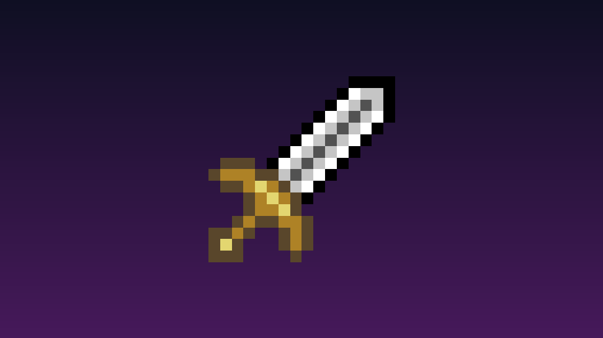

# 超强之剑 (Super Sword)



一个基于 **Fabric** 的 **Minecraft 1.20.1** 模组，添加了一把攻击力极高的自定义剑。

## 功能

- 自定义剑 **超强之剑**(`super_sword:custom_sword`)，攻击力远超原版。
- 独立的**创造模式物品栏**标签。
- 攻击特效：让目标**减速**，并**沐浴在圣光之中**。
- 右键技能：按住右键**蓄力 2 秒**，松开释放一道向前飞行的**剑气**，释放后**冷却 5 秒**。
- 剑气最远飞行 **16 格**，造成 **20 点伤害**并使目标减速；可穿过多个目标，每个目标只命中一次，遇到实体方块停止。
- 剑气呈金白色**横向立体月牙形**，朝向随发射方向固定，不随观察镜头转动；残影在约 **0.15 秒**内快速淡出。
- 可合成：2 个**铁锭** + 1 个**金锭**（竖排）。

## 环境要求

- Minecraft **1.20.1**
- Fabric Loader **>= 0.14.23**
- Fabric API（1.20.1 版本）
- Java **17+**

## 构建

```powershell
.\gradlew build
```

生成的 mod jar 位于 `build/libs/super_sword-1.3.0.jar`。

## 游戏内使用

- 获取物品：`/give @s super_sword:custom_sword`
- 合成配方：2 个铁锭 + 1 个金锭（竖排）
- 手持超强之剑，按住右键，看到“蓄力完成”提示后松开即可释放剑气。提前松开会取消蓄力，不消耗冷却；蓄满后可继续按住等待释放。
- 每次释放消耗 1 点耐久（创造模式除外）。伤害、射程可在 `SwordWave.java` 的常量中调整，蓄力和冷却时长可在 `CustomSwordItem.java` 的常量中调整。

## 安装

从 [Releases](https://github.com/DiamondAmbilight/super_sword/releases) 下载对应的 jar，放入游戏版本的 `mods` 文件夹即可。

## 许可证

MIT
